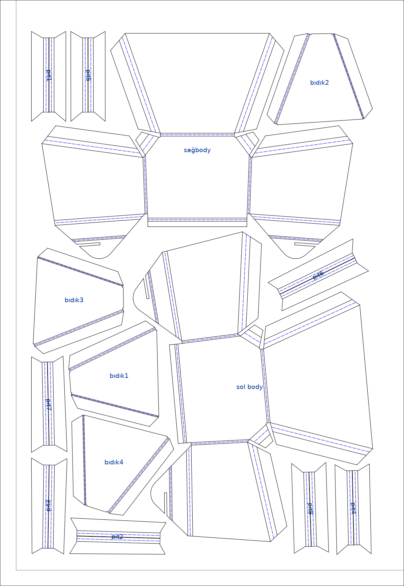
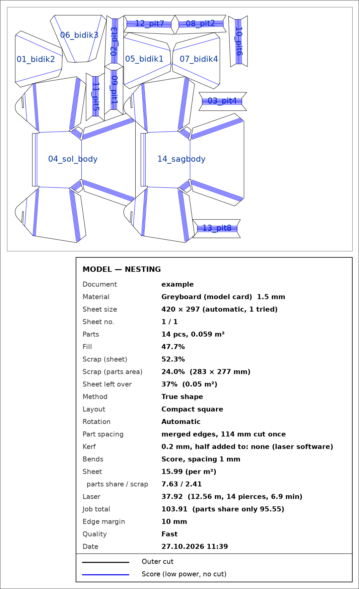

# Sheet Metal Nesting for Autodesk Fusion

**Flatten, nest and cut — in one click.** An add-in for Autodesk® Fusion™ that flattens every visible sheet metal body,
writes a DXF per part and nests them all on sheets with as little scrap as it can. Works for **sheet metal**
(laser + press brake) and for **model making** (greyboard, foam board, paper, PP, acrylic, plywood).

[](https://github.com/barisegemenbas/sheet-metal-nesting-for-fusion/releases/latest)
[](LICENSE)


[Türkçe](README.tr.md) · [Download](https://github.com/barisegemenbas/sheet-metal-nesting-for-fusion/releases/latest) ·
[User guide (PDF)](docs/USER_GUIDE.pdf) · [Report a problem](https://github.com/barisegemenbas/sheet-metal-nesting-for-fusion/issues)

<p align="center">
  
  &nbsp;
  
</p>

## Features

- **One click, your design untouched.** Every visible sheet metal body is flattened in a temporary copy; the
  original document is never changed.
- **DXF per part + nested layout.** True-shape nesting (parts by their real outline, any rotation, small parts
  into holes) or fast rectangle nesting. Least scrap, compact square or strip layouts.
- **Automatic sheet size.** Picks the smallest standard sheet that takes all parts, or use your own size.
- **Several thicknesses at once.** Each thickness is nested on its own sheet; the thickness can be changed and the
  flat pattern recomputed.
- **Laser-ready cut file.** Cut (and score) lines only — no text, no frames. A legend tells which colour is what.
- **Model making mode.** Bend strips filled with score lines (card, foam board, paper, PP), living hinges (wood),
  heat-bend marks (acrylic); optional half-kerf compensation and merged common edges.
- **PNG previews** with part names and a title block, **scrap figures** per sheet, and an optional **cost estimate**
  (sheet price per kg / m² / sheet, laser by metres + pierces or by machine minutes, bending, set-up) with a CSV
  table per part.
- **English and Turkish** interface.

## Install

1. Download `sheet-metal-nesting-for-fusion-v1.0.0.zip` from the
   [latest release](https://github.com/barisegemenbas/sheet-metal-nesting-for-fusion/releases/latest).
2. **Mac:** double-click the zip, then `Install-Mac.command`. **Windows:** right-click the zip > *Extract All*,
   then `Install-Windows.bat`.
3. Restart Fusion. The button is on the **SHEET METAL** tab.

The installer copies the add-in into Fusion's add-ins folder and sets up its own Python with the packages it needs
— no admin password, no separate Python install. Unsigned files: the first time, macOS needs *System Settings >
Privacy & Security > Open Anyway*, and Windows *More info > Run anyway*. Step-by-step: [docs/INSTALL.txt](docs/INSTALL.txt).

<details>
<summary>Manual install (developers)</summary>

Copy the `SacAcinimDXF` folder into Fusion's add-ins folder (the folder name must stay `SacAcinimDXF`):

- macOS: `~/Library/Application Support/Autodesk/Autodesk Fusion 360/API/AddIns/`
- Windows: `%APPDATA%\Autodesk\Autodesk Fusion 360\API\AddIns\`

The flattening runs inside Fusion; DXF writing and nesting run in a separate Python 3.13 that the add-in looks for
first in `SacAcinimDXF/_python`, then on the system. It needs:

```
pip install ezdxf ironnest spyrrow shapely matplotlib pillow
```

Then *UTILITIES > ADD-INS > Scripts and Add-Ins > Add-Ins*, select SacAcinimDXF, *Run*.
</details>

## Use

Open a sheet metal design, click the button, pick the material and sheet for each thickness, and press OK. The
output folder (`Documents/SheetMetal_Nesting_DXF/<document>_<date>`) opens when it is done:

| File | What |
|---|---|
| `00_CUT_….dxf` | the file for the laser: cut (and score) lines only |
| `00_NESTING_….dxf` | the layout with bend lines and the sheet frame |
| `00_NESTING_….png`, `00_CUT_….png` | pictures with part names and a title block |
| `00_COST_….csv` | cost per part (when prices are given) |
| `01_….dxf`, `02_….dxf` … | each part on its own |

**In your laser software,** give each colour its own setting: black/white = cut, red slits = cut (living hinge),
**blue = score at low power** (cutting power would split the part at the bend), green = heat-bend mark. Most laser
software compensates the kerf itself, so lines are left at true size by default.

The [user guide](docs/USER_GUIDE.pdf) covers every setting, the colours, scrap and cost, and troubleshooting.

## Requirements and known limits

- Autodesk Fusion on macOS or Windows; internet for the first setup.
- **Intel Macs:** the true-shape nesting package (ironnest) has no build for them; parts are nested as rectangles.
- **Windows:** the installer and add-in are written for Windows but have **not yet been tested on a Windows PC**.
  Reports are very welcome.
- Fusion sometimes cannot export a flat pattern; the add-in then reads the geometry itself and warns about any part
  it could not flatten completely.
- "Merge edges" only joins straight edges that lie exactly on top of each other; nesting does not line edges up on
  purpose, so usually few edges merge.
- Card does not bend like metal: a card prototype of a metal part can be off by about half a millimetre per bend
  (an estimate).

## Disclaimer

This software is provided **"as is", without warranty of any kind** (see the [MIT License](LICENSE)). It may
contain bugs. **Always check the dimensions of every DXF before cutting.** You are responsible for what you cut,
for your material and for using your laser safely. Never laser-cut PVC / Forex: it gives off toxic chlorine gas.
Cost figures are estimates from the prices you enter.

## Contributing

Bug reports, ideas and pull requests are welcome — see [CONTRIBUTING.md](CONTRIBUTING.md). When reporting a
problem, please attach the `_log.txt` from the output folder and a screenshot.

## Built with

| Package | Used for | License |
|---|---|---|
| [ezdxf](https://github.com/mozman/ezdxf) | reading and writing DXF | MIT |
| [ironnest](https://pypi.org/project/ironnest/) (jagua-rs) | true-shape nesting | MPL-2.0 |
| [spyrrow](https://github.com/PaulDL-RS/spyrrow) (sparrow) | tighter strip packing | MIT |
| [Shapely](https://github.com/shapely/shapely) | kerf offsets, clipping | BSD-3-Clause |
| [Matplotlib](https://matplotlib.org/) / [Pillow](https://python-pillow.org/) | PNG previews | PSF-based / MIT-CMU |
| [python-build-standalone](https://github.com/astral-sh/python-build-standalone) | the installer's portable Python | MPL-2.0 / PSF |

These are installed from PyPI by the installer; none of their code is included in this repository.

## Trademarks

Autodesk and Fusion are registered trademarks or trademarks of Autodesk, Inc., in the USA and other countries.
The names are used here only to say which software this add-in works with. This is an independent project, not
affiliated with, sponsored or endorsed by Autodesk, Inc. No Autodesk logos or icons are used.

## License

[MIT](LICENSE) © 2026 barisegemenbas
