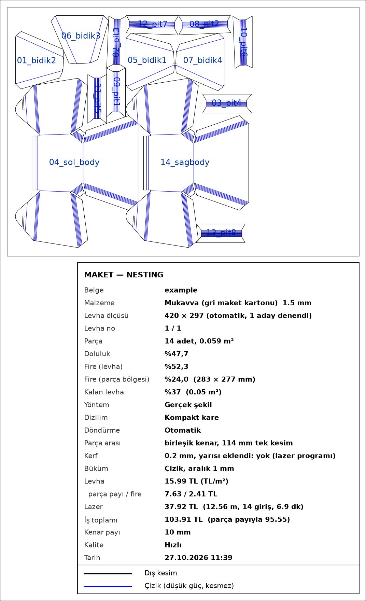

# Autodesk Fusion için Sac Açınım / Nesting

**Açınım, dizim, kesim — tek tıkla.** Autodesk® Fusion™ için bir eklenti: görünür her sheet metal gövdenin açınımını
çıkarır, her parçayı DXF yapar ve hepsini levhaya en az fireyle dizer. **Sac metal** (lazer + abkant) ve **maket**
(mukavva, kapa, kağıt, PP, pleksi, kontrplak) için.

[English](README.md) · [İndir](https://github.com/barisegemenbas/sheet-metal-nesting-for-fusion/releases/latest) ·
[Kullanım kılavuzu (PDF)](docs/KULLANIM.pdf) · [Sorun bildir](https://github.com/barisegemenbas/sheet-metal-nesting-for-fusion/issues)

  
  &nbsp;
  

## Özellikler

- **Tek tık, tasarımına dokunmaz.** Açınım geçici kopyada çıkarılır; asıl belge hiç değişmez.
- **Parça başına DXF + dizilim.** Gerçek şekil dizimi (parçanın kendi şekliyle, her açıda, küçük parçalar
  deliklere) ya da hızlı dikdörtgen dizim. En az fire, kompakt kare veya şerit.
- **Otomatik levha ölçüsü.** Bütün parçaların sığdığı en küçük standart levhayı seçer; istersen kendi ölçün.
- **Birden çok kalınlık.** Her kalınlık kendi levhasına dizilir; kalınlık değiştirilip açınım yeniden hesaplanabilir.
- **Lazere hazır kesim dosyası.** Yalnız kesim (ve çizik) çizgileri; yazı yok, çerçeve yok.
- **Maket modu.** Büküm şeridi çiziklerle dolar (karton, kapa, kağıt, PP), ahşapta esnek menteşe, pleksi için
  ısıyla büküm işareti; isteğe bağlı yarım kerf payı ve ortak kenar birleştirme.
- **PNG önizleme** (parça adları, başlık bloğu), levha başına **fire** ve isteğe bağlı **maliyet** (kg / m² / levha
  fiyatı, metre + giriş ya da dakika ile lazer, büküm, hazırlık) ve parça başına CSV tablo.
- **Türkçe ve İngilizce** arayüz.

## Kurulum

1. [Son sürümden](https://github.com/barisegemenbas/sheet-metal-nesting-for-fusion/releases/latest)
   `sheet-metal-nesting-for-fusion-v1.0.0.zip` dosyasını indir.
2. **Mac:** zip'e çift tıkla, sonra `Install-Mac.command`. **Windows:** zip'e sağ tık > *Tümünü ayıkla*, sonra
   `Install-Windows.bat`.
3. Fusion'ı yeniden başlat. Buton **SHEET METAL** sekmesinde.

Kurulum dosyası eklentiyi Fusion'ın eklenti klasörüne koyar ve kendi Python'unu paketleriyle kurar; yönetici
şifresi ya da ayrıca Python kurmak gerekmez. Dosyalar imzasız olduğu için ilk seferde Mac'te *Sistem Ayarları >
Gizlilik ve Güvenlik > Yine de Aç*, Windows'ta *Ek bilgi > Yine de çalıştır* gerekir. Adım adım:
[docs/KURULUM.txt](docs/KURULUM.txt).

## Kullanım

Sheet metal bir tasarım açıkken butona bas, her kalınlık için malzemeyi ve levhayı seç, OK de. Bitince çıktı
klasörü (`Belgeler/Sac_Acinim_DXF/<belge>_<tarih>`) açılır:

| Dosya | Ne |
|---|---|
| `00_KESIM_….dxf` | lazere giden dosya: yalnız kesim (ve çizik) |
| `00_NESTING_….dxf` | büküm çizgileri ve levha çerçevesiyle dizilim |
| `00_NESTING_….png`, `00_KESIM_….png` | parça adları ve başlık bloğuyla resimler |
| `00_MALIYET_….csv` | parça başına maliyet (fiyat girildiyse) |
| `01_….dxf`, `02_….dxf` … | her parça ayrı |

**Lazer programında** her renge ayrı ayar ver: siyah/beyaz = kes, kırmızı yarıklar = kes (menteşe), **mavi = düşük
güçle çizik** (kesim gücü parçayı büküm yerinden ayırır), yeşil = ısıyla büküm işareti. Çoğu lazer programı kerfi
kendisi düzelttiği için çizgiler varsayılan olarak gerçek ölçüde bırakılır.

Her ayar, renkler, fire, maliyet ve sorunlar: [kullanım kılavuzu](docs/KULLANIM.pdf).

## Gerekenler ve bilinen sınırlar

- macOS ya da Windows'ta Autodesk Fusion; ilk kurulum için internet.
- **Intel Mac:** gerçek şekil dizimi paketi (ironnest) yok; parçalar dikdörtgen dizilir.
- **Windows:** kurulum ve eklenti Windows için yazıldı ama **henüz gerçek bir Windows'ta denenmedi**. Geri
  bildirim çok işe yarar.
- Fusion bazen açınımı DXF'e aktaramıyor; eklenti o zaman geometriyi kendisi okur ve tam açılamayan parçayı bildirir.
- "Kenarları birleştir" yalnız tam üst üste gelen düz kenarları birleştirir; genelde az kenar birleşir.
- Karton sacla aynı bükülmez: sac parçanın karton prototipi büküm başına yaklaşık yarım milimetre şaşabilir (tahmin).

## Sorumluluk reddi

Bu yazılım **"olduğu gibi", hiçbir garanti olmadan** sunulur ([MIT Lisansı](LICENSE)). Hatalar olabilir.
**Kesmeden önce her DXF'in ölçüsünü kontrol et.** Kestiğin şeyden, malzemeden ve lazeri güvenli kullanmaktan sen
sorumlusun. PVC / foreks lazerde asla kesilmez: zehirli klor gazı çıkar. Maliyetler girdiğin fiyatlara göre
tahmindir.

## Katkı

Hata bildirimi, fikir ve pull request'ler açık: [CONTRIBUTING.md](CONTRIBUTING.md). Sorun bildirirken çıktı
klasöründeki `_log.txt`'yi ve bir ekran görüntüsünü ekle.

## Markalar

Autodesk ve Fusion, Autodesk, Inc.'in ABD'de ve diğer ülkelerde tescilli markaları ya da markalarıdır. Bu adlar
burada yalnız eklentinin hangi yazılımla çalıştığını söylemek için kullanılır. Bu bağımsız bir projedir; Autodesk,
Inc. ile bağlantılı değildir, onun tarafından desteklenmez ya da onaylanmaz. Autodesk logosu ya da simgesi kullanılmaz.

## Lisans

[MIT](LICENSE) © 2026 barisegemenbas
